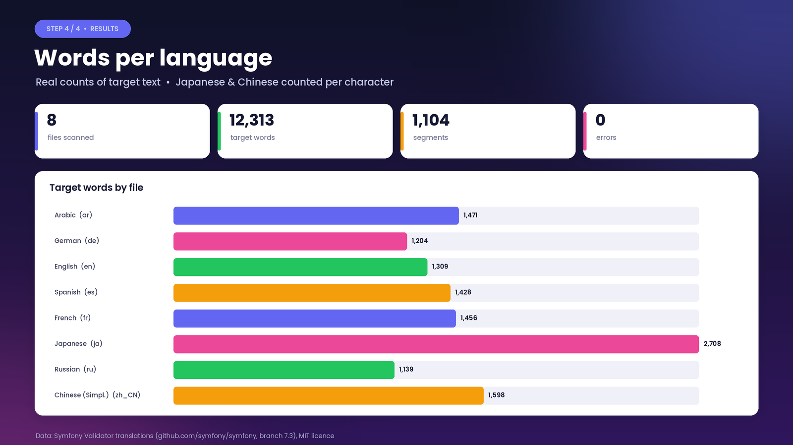
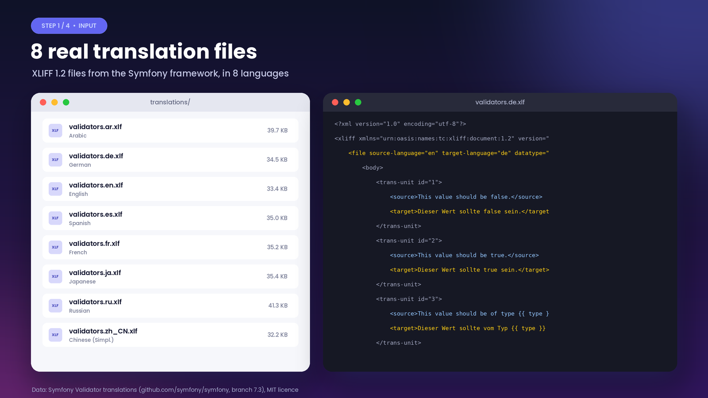
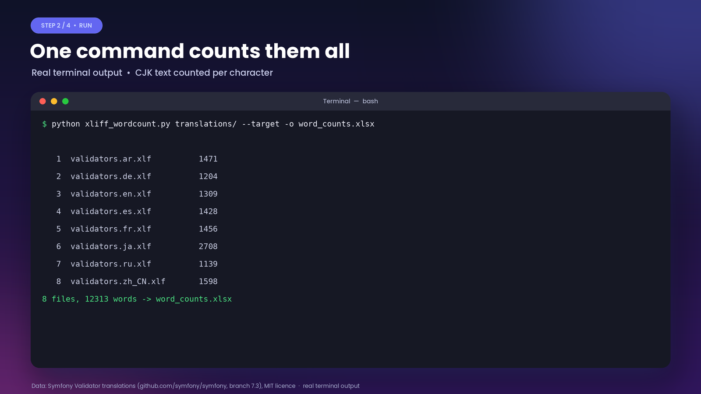
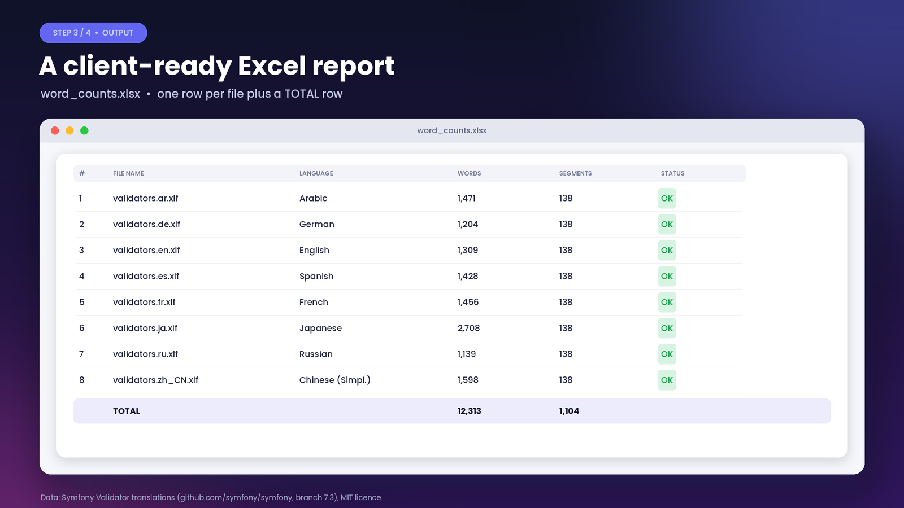

# Batch XLIFF Word Counter

Counts translatable words in every XLIFF file in a folder and writes a client-ready Excel report.



[▶ Watch the 38-second demo video](docs/demo.mp4)

## Problem
Translation agencies and freelancers quote and invoice by word count. When a project has dozens of `.xlf` files, opening each one in a CAT tool and copying the numbers into a spreadsheet takes hours and invites mistakes.

## Solution
`xliff_wordcount.py` scans a folder (optionally recursively) and:
- Reads XLIFF 1.2 (`<trans-unit><source>`) and XLIFF 2.x (`<unit><segment><source>`), including `.xliff .xlf .sdlxliff .mqxliff`
- Ignores inline code tags (`<ph>`, `<bpt>`, `<ept>`, `<it>`, `<x/>`), so only translatable text is counted
- Counts source text by default, or target text with `--target`
- Counts CJK characters (Chinese/Japanese) as one word each
- Writes an Excel file with S.No, File Name, Word Count, Segments, Notes and a TOTAL row; unreadable files are reported, not skipped silently

## Results (real run)
Run with `--target` on the 8 real Symfony Validator translation files:

| File | Language | Words |
|---|---|---|
| validators.ar.xlf | Arabic | 1,471 |
| validators.de.xlf | German | 1,204 |
| validators.en.xlf | English | 1,309 |
| validators.es.xlf | Spanish | 1,428 |
| validators.fr.xlf | French | 1,456 |
| validators.ja.xlf | Japanese | 2,708 |
| validators.ru.xlf | Russian | 1,139 |
| validators.zh_CN.xlf | Chinese (Simpl.) | 1,598 |
| **Total** | | **12,313 words, 1,104 segments, 0 errors** |

## Quick start
```bash
pip install -r requirements.txt
python scripts/download_data.py                       # optional: fetch the 8 demo files into data/
python xliff_wordcount.py data --target -o word_counts.xlsx
```
Options: `--target` (count target instead of source), `--recursive`, `-o` output path.

## Screenshots
| | |
|---|---|
|  |  |
|  |  |

## Data source & licence
- Demo data: Symfony Validator translations, https://github.com/symfony/symfony (branch 7.3, `src/Symfony/Component/Validator/Resources/translations/`), **MIT licence**, © Fabien Potencier. Not committed here; `scripts/download_data.py` fetches them.
- Code: MIT licence, see [LICENSE](LICENSE).
